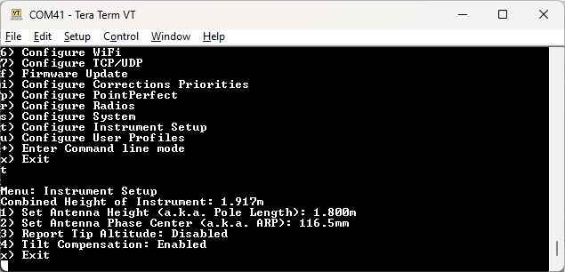

# Tilt Compensation Menu

<!--
Compatibility Icons
====================================================================================

:material-radiobox-marked:{ .support-full title="Feature Supported" }
:material-radiobox-indeterminate-variant:{ .support-partial title="Feature Partially Supported" }
:material-radiobox-blank:{ .support-none title="Feature Not Supported" }
-->

<div class="grid cards fill" markdown>

- EVK: :material-radiobox-blank:{ .support-none title="Feature Not Supported" }
- Facet mosaic: :material-radiobox-blank:{ .support-none title="Feature Not Supported" }
- FPL-T, FPM-T and FPX-T: :material-radiobox-marked:{ .support-full title="Feature Supported" }
- Postcard: :material-radiobox-blank:{ .support-none title="Feature Not Supported" }
- Torch: :material-radiobox-marked:{ .support-full title="Feature Supported" }
- TX2: :material-radiobox-blank:{ .support-none title="Feature Not Supported" }

</div>

<figure markdown>

<figcaption markdown>
Tilt Compensation menu
</figcaption>
</figure>

The Tilt Compensation menu controls how the tilt sensor is configured.

- **4** - By default, tilt compensation is enabled but can be disabled if desired.
- **1** - The pole length must be set accurately to enter tilt compensation mode. The default is 1.8 meters.

## IM19 Attitude Output

In Instrument Setup, turn on option **5**, **Output IM19 attitude (GPFMI)**. The
same setting appears under **Instrument Configuration** on the web page and as
`enableTiltAttitude` in the CLI. It defaults to off. The attitude control
appears when the firmware recognizes an IM19.

With tilt compensation enabled in rover mode, the receiver forwards one native
sentence for each new UTC accepted by the buffer. Output continues on entry to setup from rover.
The sentence goes to enabled Bluetooth, TCP, UDP and USB GNSS forwarding outputs.
On models with host logging, the ESP32 host SD log also records it. The Torch has
streaming outputs only. A direct GNSS port carries the GNSS module's own output.

Attitude sentences share the output buffer with GNSS data. A busy or full buffer
can drop an attitude sentence. With attitude enabled, a slow output can lose
older GNSS data sooner.

Turning off attitude output stops forwarding. While tilt is running, the receiver
confirms OFF after ten seconds of new binary navigation messages (NAVI) without a
valid `$GPFMI`. It retries OFF if attitude sentences keep arriving.

If attitude output may still be on when tilt stops, the receiver tries OFF up to
three times over about three seconds. It confirms OFF after three attitude
intervals (600 ms) with new NAVI messages and no valid `$GPFMI`. It reports
continued attitude output or too little navigation to confirm OFF. If all three
attempts fail to stop the IM19, it can keep sending `$GPFMI` until tilt
compensation starts again or the receiver restarts.

```text
$GPFMI,UTC,Lat,Lon,HGT,ROLL,PITCH,YAW,HRMS,NSAT,AGEDIFF,NAVMOD,STATUS*HH<CR><LF>
```

| Fields | Meaning |
|--------|---------|
| `UTC` | UTC time of day as `hhmmss.ss`. Match this to GGA or RMC and use RMC for the date, including at midnight. |
| `Lat`, `Lon`, `HGT` | Fused latitude and longitude in signed decimal degrees and height in meters. The configured pole length affects the reported position. |
| `ROLL`, `PITCH`, `YAW` | IM19 angles in radians. Multiply by 180 and divide by pi for degrees. RMC course gives the direction of travel. |
| `HRMS`, `NSAT`, `AGEDIFF`, `NAVMOD` | Horizontal RMS position error, satellite count, differential correction age and GNSS solution mode, as reported by the IM19. |
| `STATUS`, `HH` | The full 32-bit IM19 navigation status in eight hex digits, followed by the two-digit NMEA checksum. |

Check the status bits before using the angles. The IM19 can send a sentence before
its filter has converged. For example, `0x00000001` means the filter is uninitialized,
`0x00000008` flags excessive tilt, `0x00010000` flags lost GNSS and `0x00020000`
marks initialization complete. Several bits can be set at once.

## Entering Tilt Compensation Mode

To use Tilt Compensation, the user must indicate to the IMU to begin calibration by shaking the device. Then, once the IMU has calculated its position on the end of the pole, Tilt Compensation will be active.

During Tilt Compensation, all outgoing NMEA messages are modified to output the location *of the tip of the pole*. The Data Collector software will not be aware that the position of the GNSS receiver position is being modified. Moving the tip of the pole is allowed. Tilt up to 30 degrees will introduce less than 10mm of inaccuracy. Tilt up to 60 degrees will introduce less than 20mm of inaccuracy.

If the audible beeper is enabled, a long beep will be heard when the IMU starts calibration (by shaking). A short beep will be heard when the IMU completes calibration and Tilt Compensation is active. A short beep will continue every 10 seconds to let the user know Tilt Compensation is being applied.

!!! info "Tilt Affects Point Altitude"
    During tilt compensation the reported location is that *of the tip of the pole*. If Tilt mode is exited for whatever reason, the reported location and altitude of the device will change significantly. It is recommended the user use, listen for, and confirm the audible beep before recording a point in order to avoid recording an inaccurate location and altitude.

Tilt Compensation mode will be exited when the user short presses the power button, and a long beep will be heard. Additionally, Tilt Compensation mode will be exited if RTK Fix is lost. When this happens, the IMU will attempt to re-enter Tilt Compensation mode if RTK Fix is re-achieved.

Tilt compensation mode can be entered using the following steps:

1. The device must be in Rover mode.
2. The device must achieve an RTK Fix.
3. The pole length must be accurately configured. By default, this is 1.8 meters.
4. Once the above requirements are met, the device must be shaken. This is normally a strong up/down vertical motion. However, if it is more comfortable, the device can be positioned horizontally over the shoulder and shaken with a strong forward/backward motion.
5. On devices that support it, the device will emit a chirp once Tilt Mode is started.
6. Place the tip of the device on the ground. Move the head of the device back and forth up to ~30 degrees of tilt. Repeat on the opposite axis.
7. On devices that support it, the device will emit a long chirp once Tilt Compensation Mode is active. The device is now outputting the *location of the tip* of the pole.
8. Exit Tilt Compensation Mode by short pressing the power button.

## Height of Instrument Calculation

During tilt compensation, the length of the pole, and the APC (antenna phase center) must be accurately configured. It is recommended to leave the default APC (116.5mm for the RTK Torch) and use a 1.8m length pole. Once tilt is activated, the IMU will automatically adjust the reported location *from* the APC *to* the pole tip.

The pole length is the distance measured from the pole tip (usually on the ground) to where the bottom of the RTK device interfaces with the pole.

The Antenna Phase Center is the theoretical point where the GNSS signals are effectively received by the antenna. It is not necessarily (and is rarely) the physical surface of the antenna element. The APC is the measured distance between this known point in space and the bottom surface of the RTK device (also known as the Antenna Reference Point or ARP).

How do we find this 'known point in space'? Antenna APCs are estimated using various mathematical models then measured and calibrated using services provided by the [NGS](https://geodesy.noaa.gov/ANTCAL/) or other agencies.